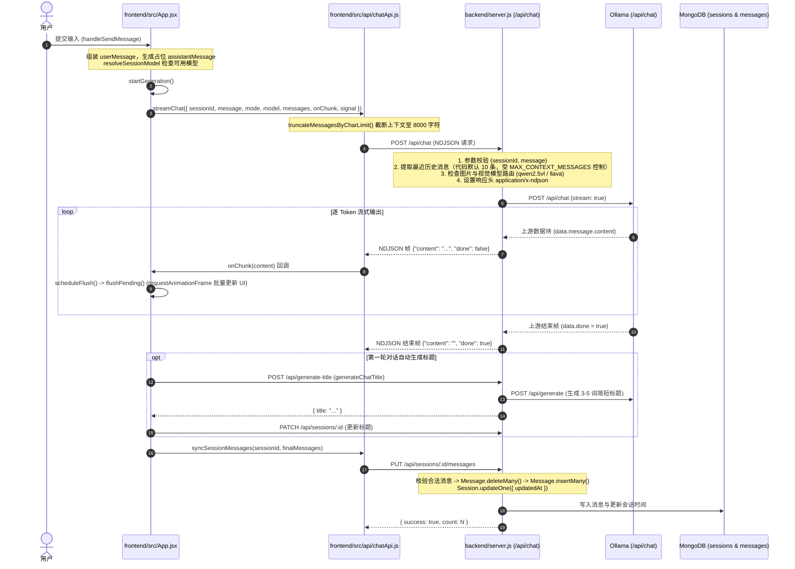
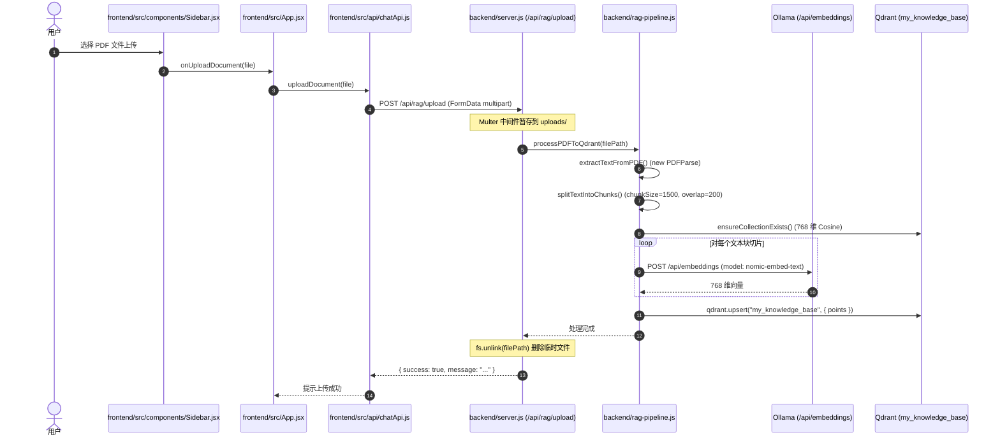
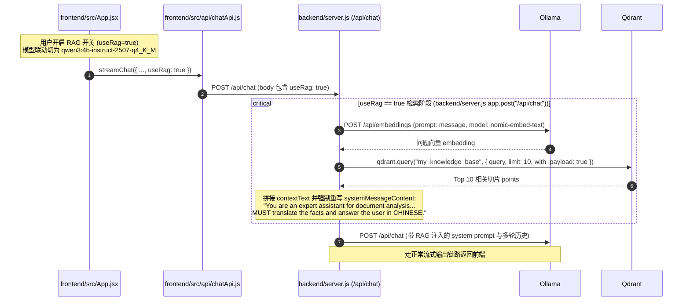

# Local AI Chat 系统架构文档 (ARCHITECTURE.md)

> **说明**：文档中所标注的代码行号随日常演进变动，仅供参考定位；所有技术结论均以函数名、路由名及实际逻辑为准。

本文档基于对 `backend/server.js`、`backend/rag-pipeline.js`、`backend/models/*`、`frontend/src/App.jsx` 以及 `frontend/src/api/chatApi.js` 等源码的严格梳理编写，记录当前系统的组件依赖、通信流程、数据存储模型、已确认风险及配置硬编码现状。

---

## 1. 系统组件关系图

系统由 **前端（React 19 + MUI）**、**后端 API 服务（Express 5）**、**文档数据库（MongoDB）**、**本地推理引擎（Ollama）** 及 **向量数据库（Qdrant）** 五个核心部分组成：

```mermaid
graph TD
    subgraph Client ["前端客户端 (Browser / React 19)"]
        UI["UI 组件层 (App.jsx, ChatInput, MessageList, Sidebar)"]
        ChatApi["API 交互层 (chatApi.js)"]
        LocalStorage["浏览器 LocalStorage (主题, 侧边栏, 提示词模板)"]
        UI <--> LocalStorage
        UI --> ChatApi
    end

    subgraph Backend ["后端服务 (Node.js / Express 5)"]
        Server["Express 核心路由 (server.js)"]
        RagPipeline["RAG 管道 (rag-pipeline.js)"]
        MongooseModels["Mongoose 模型 (Session.js, Message.js)"]
        MulterStorage["临时文件存储 (uploads/)"]
        Server --> RagPipeline
        Server --> MongooseModels
        Server --> MulterStorage
    end

    subgraph Storage ["数据持久化"]
        MongoDB[("MongoDB (27017)\nlocal_ai_chat\n- sessions\n- messages")]
        Qdrant[("Qdrant (6333)\nCollection: my_knowledge_base\n向量维度: 768 Cosine")]
    end

    subgraph Inference ["本地模型推理"]
        Ollama[("Ollama (11434)\n- /api/chat (推理)\n- /api/generate (标题)\n- /api/embeddings (向量化)\n- /api/tags (模型检测)")]
    end

    ChatApi -->|HTTP REST / NDJSON 流式| Server
    MongooseModels <-->|Mongoose ODM| MongoDB
    Server <-->|Axios HTTP 流式 / REST| Ollama
    RagPipeline <-->|Axios /api/embeddings| Ollama
    RagPipeline <-->|@qdrant/js-client-rest| Qdrant
    Server <-->|@qdrant/js-client-rest 检索| Qdrant
```

---

## 2. 普通聊天请求完整流程

从用户在前端输入并点击发送，到大模型流式输出完毕，再到落库 MongoDB 的端到端流程：



### 关键步骤与函数索引

1. **用户触发发送**：`frontend/src/App.jsx` 的 `handleSendMessage`。
2. **上下文组装与占位**：`handleSendMessage` 构造 `userMessage`，调用 `startGeneration` 挂载 `assistantPlaceholder`。
3. **前端防越界截断与流式调度**：`frontend/src/api/chatApi.js` 的 `streamChat` 内部调用 `truncateMessagesByCharLimit` 裁剪至安全字符数（8000 字符），并通过 `fetch` 发起 POST 请求。
4. **后端接收与校验、视觉路由**：`backend/server.js` 路由 `app.post("/api/chat")`，校验参数、截取最近消息（代码硬编码默认值为 10 条，受环境变量 `MAX_CONTEXT_MESSAGES` 控制）、检测是否含 base64 图片以自动轮换视觉模型。
5. **后端转发 Ollama 与 NDJSON 封装**：`backend/server.js`，Axios 向 Ollama `/api/chat` 建立流式连接，监听上游并通过 `StringDecoder` 按 `\n` 切割，封装为 NDJSON 推送给前端。
6. **前端批处理渲染**：`frontend/src/App.jsx` 的 `scheduleFlush` 与 `flushPending` 通过 `requestAnimationFrame` 缓冲并平滑更新 React 状态。
7. **落库同步**：`frontend/src/App.jsx` 的 `startGeneration` 在 `finally` 块触发 `syncSessionMessages`（`chatApi.js`），后端 `PUT /api/sessions/:id/messages` 执行先清空后批量插入。

---

## 3. RAG 请求完整流程

### 链路 A：PDF 上传与向量化入库



### 链路 B：提问时知识库检索与 System Prompt 覆盖



---

## 4. 数据存储表

### 4.1 MongoDB 存储结构（`local_ai_chat` 数据库）

#### 集合 1: `sessions` (`backend/models/Session.js`)

| 字段名         | 类型    | 必填 | 默认值       | 说明与索引                                             |
| :------------- | :------ | :--: | :----------- | :----------------------------------------------------- |
| `id`           | String  |  是  | -            | 业务唯一标识符，格式为 `session_${uuid}`，**唯一索引** |
| `title`        | String  |  是  | `"New Chat"` | 会话标题（初始截取或 LLM 提炼）                        |
| `mode`         | String  |  否  | `"chat"`     | 会话模式，枚举 `["chat", "code"]`                      |
| `model`        | String  |  是  | -            | 该会话绑定的 Ollama 模型名称                           |
| `systemPrompt` | String  |  否  | `""`         | 用户自定义系统提示词                                   |
| `isPinned`     | Boolean |  否  | `false`      | 是否置顶，**普通索引**                                 |
| `createdAt`    | Date    | 自动 | 当前时间     | Mongoose `timestamps: true` 自动生成                   |
| `updatedAt`    | Date    | 自动 | 当前时间     | Mongoose `timestamps: true` 自动生成                   |

#### 集合 2: `messages` (`backend/models/Message.js`)

| 字段名        | 类型   | 必填 | 默认值      | 说明与索引                                       |
| :------------ | :----- | :--: | :---------- | :----------------------------------------------- |
| `id`          | String |  是  | -           | 消息唯一标识，格式为 `msg_${uuid}`，**唯一索引** |
| `sessionId`   | String |  是  | -           | 归属会话 ID，**普通索引**                        |
| `role`        | String |  是  | -           | 角色，枚举 `["user", "assistant"]`               |
| `content`     | String |  是  | -           | 消息正文文本                                     |
| `file`        | String |  否  | `undefined` | 附加文件的原始文件名                             |
| `fileContent` | String |  否  | `undefined` | 附加纯文本文件的提取内容                         |
| `imageBase64` | String |  否  | `undefined` | 图片附件 base64 数据编码                         |
| `mimeType`    | String |  否  | `undefined` | 附件文件 MIME 类型                               |
| `createdAt`   | String |  否  | -           | 前端传入的 ISO 8601 时间戳字符串                 |
| `updatedAt`   | Date   | 自动 | 当前时间    | Mongoose `timestamps: true` 自动生成             |

### 4.2 Qdrant 向量库存储结构

- **集合名称**：`my_knowledge_base`
- **向量配置**：尺寸 768 维，距离度量 `Cosine`
- **Point 数据结构** (`backend/rag-pipeline.js` 中 `processPDFToQdrant`)：
  - `id`: UUID v4 (`uuidv4()`)
  - `vector`: 768 维浮点数数组
  - `payload`:
    - `text` (String): 切片正文（chunk）
    - `source` (String): 上传时暂存文件路径（如 `uploads/xxx`）
    - `chunkIndex` (Number): 切片在原文档中的次序索引（从 0 开始）

### 4.3 浏览器 LocalStorage 存储项

| Key 键名                          | 存储类型                       | 所在文件及位置                           | 说明                                  |
| :-------------------------------- | :----------------------------- | :--------------------------------------- | :------------------------------------ |
| `local_ai_chat_theme`             | String (`"light"` 或 `"dark"`) | `frontend/src/App.jsx`                   | 保存用户选择的界面明暗主题            |
| `local_ai_chat_sidebar_collapsed` | String (`"true"` 或 `"false"`) | `frontend/src/App.jsx`                   | 保存侧边栏折叠/展开状态               |
| `local_ai_chat_custom_prompts`    | JSON String (Array)            | `frontend/src/hooks/useCustomPrompts.js` | 用户自定义全局 System Prompt 模板列表 |

---

## 5. 已发现的风险点清单 (源码证实)

### 5.1 确认的缺陷与风险

1. **全量覆盖式写库存在直接数据丢失风险与并发冲突**
   - **文件位置**：`backend/server.js`，路由 `app.put("/api/sessions/:id/messages")`
   - **说明**：同步消息采用先 `Message.deleteMany({ sessionId: id })` 再 `Message.insertMany(...)` 的全量替换策略且未启用事务。最直接的致命风险在于：若 `deleteMany` 执行成功后 `insertMany` 抛出异常（如数据库瞬断、校验错误或连接断开），该会话所有历史消息将被永久物理删除且无法恢复；并发请求或重试竞争时也会导致消息瞬间为空或旧数据覆盖新数据。
2. **Qdrant 存储的文档源路径为已删除的临时文件**
   - **文件位置**：`backend/server.js` 路由 `app.post("/api/rag/upload")`，`backend/rag-pipeline.js` 函数 `processPDFToQdrant`
   - **说明**：上传文档时传入 RAG pipeline 的是 Multer 生成的暂存路径（`uploads/xxx`），存入 Qdrant payload 的 `source` 为此临时磁盘路径，而入库完成后临时文件立即被 `fs.unlink(filePath)` 删除。这导致向量库中的来源追踪信息彻底失效，无法根据真实文件名（`req.file.originalname`）进行溯源或文档管理。
3. **向量维度 768 硬编码缺乏灵活性**
   - **文件位置**：`backend/rag-pipeline.js`，函数 `ensureCollectionExists`
   - **说明**：集合创建逻辑中将 `vectors: { size: 768, distance: "Cosine" }` 硬编码绑定到 `nomic-embed-text`。若后续更换为其他维度的嵌入模型（如 1024 维的 bge-large 或 1536 维模型），在未手动删除重建集合的情况下，插入或查询时将直接抛出维度不匹配异常。
4. **RAG 模式强行覆盖用户 Prompt 并硬编码中文输出设定**
   - **文件位置**：`backend/server.js`，路由 `app.post("/api/chat")`
   - **说明**：当 `useRag=true` 且检索成功时，后端无条件丢弃当前会话已配置的 `customSystemPrompt` 或默认模式 Prompt，强制覆盖为假设上下文是英文且必须以中文回答的提示词（`"The Context is in English, but you MUST translate the facts and answer the user in CHINESE"`），破坏了多语言问答支持与用户的个性化系统提示词设定。
5. **PDF 上传缺乏体积大小与文件类型校验中间件限制**
   - **文件位置**：`backend/server.js`，中间件配置 `upload = multer({ dest: "uploads/" })` 及路由 `app.post("/api/rag/upload")`
   - **说明**：Multer 初始化未配置 `limits.fileSize` 和 `fileFilter` 限制，用户可随意上传超大文件或伪造扩展名的非法格式文件，容易引发磁盘占用枯竭或 `pdf-parse` 进程内存溢出崩溃。
6. **服务监听未指定 Host 且完全缺乏身份认证控制**
   - **文件位置**：`backend/server.js`，启动入口 `connectDB().then(() => { app.listen(PORT, ...) })`
   - **说明**：`app.listen(PORT, ...)` 未传入 host 参数，在 Node.js 中不指定 host 时默认监听所有网卡（支持 IPv6 的机器上是 `::`，同时覆盖 IPv4），且整套后端所有 API 路由均无 JWT、API-Key 或 Session 等认证中间件。同一局域网下的任意设备只要知晓端口均可直接调用接口、读取/清空全部历史消息或上传向量数据。
7. **大图 Base64 直接内嵌存入 Message 文档存在突破 MongoDB 16MiB 限制风险**
   - **文件位置**：`backend/models/Message.js`（`imageBase64` 字段），`backend/server.js`（`app.use(express.json({ limit: "20mb" }))` 及 `PUT /api/sessions/:id/messages`）
   - **说明**：前端支持上传图片并转为 base64 存入 Message 文档，且后端 `express.json` 放宽到了 20MB。然而 MongoDB 引擎对单个 BSON 文档施加了严格的 16MiB 大小上限。当用户在单轮或消息中附加高分辨率大图时，生成的 Message 文档将直接超过 16MiB 导致 `Message.insertMany` 崩溃报错，且当前前后端均缺少图片压缩与尺寸限制处理。
8. **RAG 检索异常在后端静默捕获，前端与用户完全无感知**
   - **文件位置**：`backend/server.js`，路由 `app.post("/api/chat")`
   - **说明**：当 `useRag=true` 时，若 Ollama embedding 接口失败或 Qdrant 检索不可用，其 `catch (error)` 仅打印了 `console.error("❌ [RAG] Retrieval failed:", error.message)` 便静默放行，继续走普通聊天。前端与用户得不到任何“知识库不可用”或“已降级为通用模型回答”的提示，容易产生误导。
9. **前端多处数据同步 fetch 未校验 response.ok**
   - **文件位置**：`frontend/src/App.jsx`
   - **说明**：在以下异步操作函数中，前端发起网络请求后均未检查 `response.ok`，无论后端返回 4xx 还是 5xx 状态码，前端均盲目假定成功并执行本地状态变更，造成前后端状态不同步：
     - `handleNewChat`：`POST /api/sessions` 失败未检查；
     - `handleRenameSession`：`PATCH /api/sessions/:id` 失败未检查；
     - `handleDeleteSession`：`DELETE /api/sessions/:id` 失败未检查；
     - `handleModeChange`：`PATCH /api/sessions/:id`（持久化 mode/model）失败未检查；
     - `handleModelChange`：`PATCH /api/sessions/:id`（持久化 model）失败未检查；
     - `startGeneration`：首轮会话保存 `metaPatch`（title/model）及后续自动生成标题后 `PATCH /api/sessions/:id` 均未检查；
     - `handleClearChat`：重命名为 "New Chat" 的 `PATCH /api/sessions/:id` 未检查。
       - `handleClearAllChats`：清空后创建新会话的 `POST /api/sessions` 未检查；
     - `handleDeleteSession`：删除最后一个会话后自动新建会话的 `POST /api/sessions` 未检查。
10. **全量会话聚合查询采用 $lookup 一次性返回全部消息导致性能隐患**
    - **文件位置**：`backend/server.js`，路由 `app.get("/api/sessions")`
    - **说明**：会话列表查询使用 `$lookup` 将 `messages` 集合全量关联并一次性返回前端，未做会话分页、消息条数限制或字段投影（如排除高消耗的 `fileContent`、`imageBase64`）。随着用户对话数据累积，该接口的内存开销与传输负载将呈线性恶化，导致前端首屏加载显著变慢。
11. **RAG 开启并附带文本文件时全文拼入 message 作为检索 Prompt 导致语义污染**
    - **文件位置**：`frontend/src/App.jsx`（函数 `toApiMessage` 及 `handleSendMessage`），`backend/server.js`（路由 `app.post("/api/chat")`）
    - **说明**：当用户在聊天框附加文本文件时，`toApiMessage` 会将文件名、系统标记及整个文件正文完整拼接到用户问题后作为 `content`，并在 `handleSendMessage` 中赋值给 `requestContent` 并作为 `message` 参数发往后端。若此时开启了 RAG（`useRag=true`），后端直接将包含几千字文件正文的整个 `message` 传给 Ollama `/api/embeddings` 作为检索问题生成向量。这会导致向量语义被冗长的文件内容严重稀释和污染，Qdrant 无法检索到与真实提问相关的知识库切片，甚至导致 embedding 接口超过模型上下文上限或超时。

### 5.2 待验证事项 (待测试确认)

1. **前后端上下文截断策略差异**：前端 `chatApi.js` 使用字符数限制（8000 字符），后端 `server.js` 使用条数限制（代码默认 10 条）。在单条超长消息或连续短消息场景下，两端实际送入 Ollama 的上下文窗口是否可能产生非预期的裁切行为，待进一步测试验证。
2. **客户端非正常断开时上游流的资源回收**：`backend/server.js` 在 `res.on("close")` 时执行了 `abortController.abort()`，但在网络异常僵死时 upstream stream 的销毁彻底程度待压测验证。
3. **离线 fallback 会话与无外键级联的消息同步产生的孤立消息风险**：当后端不可用时，`frontend/src/App.jsx` 的 catch 分支创建了本地 fallback 会话但并未（且无法）写入数据库。若随后网络恢复且该会话发送了消息，前端触发 `PUT /api/sessions/:id/messages`，因后端该接口仅对 `Session.updateOne({ id })` 做更新而不检查该 Session 在数据库中是否真实存在（无外键约束），推测可能会在 `messages` 集合中插入一批无对应父级 Session 的孤立消息数据。

---

## 6. 前后端配置重复项与硬编码清单

| 配置项                                  | 涉及文件                                                                                               | 具体硬编码值 / 差异说明                                                                                                                                               |
| :-------------------------------------- | :----------------------------------------------------------------------------------------------------- | :-------------------------------------------------------------------------------------------------------------------------------------------------------------------- |
| **Qdrant 服务地址**                     | `backend/server.js`<br/>`backend/rag-pipeline.js`<br/>`backend/rag-chat.js`<br/>`backend/rag-query.js` | 全部硬编码 `"http://localhost:6333"`，`server.js` 中未读取任何环境变量                                                                                                |
| **Qdrant 知识库集合名称**               | `backend/server.js`<br/>`backend/rag-pipeline.js`<br/>`backend/rag-chat.js`<br/>`backend/rag-query.js` | 全部重复硬编码 `"my_knowledge_base"`，无统一配置来源                                                                                                                  |
| **Embedding 模型名称**                  | `backend/server.js`<br/>`backend/rag-pipeline.js`<br/>`backend/rag-chat.js`<br/>`backend/rag-query.js` | 全部重复硬编码 `"nomic-embed-text"`                                                                                                                                   |
| **Ollama 服务地址**                     | `backend/server.js`<br/>`backend/rag-pipeline.js`<br/>`backend/rag-chat.js`<br/>`backend/rag-query.js` | `server.js` 与 `rag-pipeline.js` 读取 `OLLAMA_URL` 兜底 `http://localhost:11434`，而两个测试脚本直接硬编码                                                            |
| **默认聊天/代码模型**                   | `backend/server.js`<br/>`frontend/src/App.jsx`<br/>`backend/rag-chat.js`                               | 前端硬编码 `llama3.2:3b` 与 `qwen3:4b-instruct-2507-q4_K_M`；后端环境变量与前端默认值彼此独立脱节                                                                     |
| **后端 API 基础路径**                   | `frontend/src/api/chatApi.js`<br/>`backend/server.js`                                                  | 前端默认兜底 `http://localhost:5000/api`；后端默认 `PORT = 5000`                                                                                                      |
| **上下文与输出 Token 参数默认值不一致** | `backend/server.js`<br/>`backend/.env.example`                                                         | **代码默认值**为 `MAX_CONTEXT_MESSAGES=10`、`MAX_OUTPUT_TOKENS=1024`；而 **`.env.example`** 中的预设值为 `MAX_CONTEXT_MESSAGES=6`、`MAX_OUTPUT_TOKENS=2048`，两者脱节 |
