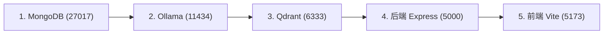

# Local AI Chat 本地启动基线与功能验收清单 (BASELINE.md)

本文档定义了项目从零启动的完整命令顺序、服务状态判定准则，以及 15 项核心基线功能的手工回归测试检查表。

---

## 1. 从零启动命令顺序与服务就绪判定

启动依赖顺序如下：**MongoDB -> Ollama -> Qdrant -> 后端 Express -> 前端 Vite**。



### 步骤 1：启动 MongoDB 数据库
- **运行命令**：
  - Windows 服务方式：确保 `MongoDB` 服务已处于 Running 状态；或命令行启动：
    ```powershell
    net start MongoDB
    # 或手动指定数据目录启动
    mongod --dbpath <数据目录路径>
    ```
- **成功判定方式**：
  - 打开终端执行 `mongosh --eval "db.adminCommand('ping')"`，输出 `{ ok: 1 }`；
  - 或默认监听端口 `27017` 处于通畅状态。

### 步骤 2：启动 Ollama 并拉取基线模型
- **运行命令**：
  - 启动 Ollama 桌面客户端；或在终端后台运行：
    ```bash
    ollama serve
    ```
  - 拉取项目必需的 3 个基线模型及 1 个可选视觉模型：
    ```bash
    # 默认通用聊天模型
    ollama pull llama3.2:3b

    # 默认代码助手与 RAG 问答模型
    ollama pull qwen3:4b-instruct-2507-q4_K_M

    # RAG 知识库嵌入向量模型（必需）
    ollama pull nomic-embed-text

    # 图片多模态视觉模型（可选，用于处理图片上传）
    ollama pull qwen2.5vl:3b
    ```
- **成功判定方式**：
  - 浏览器访问 `http://localhost:11434`，页面显示 `Ollama is running`；
  - 运行 `ollama list`，确认列表中包含上述模型。

### 步骤 3：使用 Docker Compose 启动 Qdrant 向量数据库
- **运行命令**（在项目根目录下执行）：
  ```bash
  docker compose up -d qdrant
  ```
- **成功判定方式**：
  - 终端运行 `docker ps`，看到 `qdrant/qdrant:latest` 容器状态为 `Up`，端口映射 `6333:6333`、`6334:6334`；
  - 浏览器访问 Qdrant 控制台 `http://localhost:6333/dashboard` 能正常显示管理界面；或访问 `http://localhost:6333` 返回包含 `"title":"qdrant - vector search engine"` 的 JSON。

### 步骤 4：安装依赖并启动后端服务
- **运行命令**：
  ```bash
  cd backend
  npm install
  npm run dev
  ```
- **成功判定方式**：
  - 终端看到如下日志输出：
    ```text
    [Database] Connected to MongoDB successfully at mongodb://localhost:27017/local_ai_chat
    Server running at http://localhost:5000
    Ollama URL: http://localhost:11434
    CORS origins: http://localhost:5173, http://127.0.0.1:5173
    ```
  - 浏览器或终端请求健康检查接口 `curl http://localhost:5000/api/health`，返回：
    ```json
    {"status":"ok","ollama":"http://localhost:11434"}
    ```

### 步骤 5：安装依赖并启动前端客户端
- **运行命令**：
  ```bash
  cd frontend
  npm install
  npm run dev
  ```
- **成功判定方式**：
  - 终端显示 Vite 本地开发服务器启动：`Local: http://localhost:5173/`；
  - 浏览器打开 `http://localhost:5173`，界面成功加载，侧边栏显示会话列表，控制台无报错。

---

## 2. 基线功能手工检查表

> 请按照下方步骤逐项执行手工验证，并在“测试结果”列中填写 `PASS` 或 `FAIL`。

| 序号 | 功能模块 | 手动测试操作步骤 | 预期结果 | 测试结果 |
| :---: | :--- | :--- | :--- | :---: |
| 1 | **普通聊天** | 在底部输入框输入 `你好，请用一句话介绍你自己`，按回车或点击发送 | AI 逐字实时流式返回回答；首条消息生成后标题自动更新（先更新为前 12 字，稍后提炼为简短标题） | |
| 2 | **停止生成** | 输入 `写一篇 1000 字的童话故事` 并发送，在生成过程中点击停止按钮或按下 `Esc` 键 | 实时生成立即中断，已输出的内容完整保留在界面中，且页面无崩溃 | |
| 3 | **编辑重发** | 悬停在已发送的用户消息上，点击编辑按钮，修改文字为 `总结一下量子计算的核心概念` 并保存 | 该消息之后的所有历史对话被截断，AI 基于修改后的新内容重新流式生成回复 | |
| 4 | **重新生成** | 点击最后一条 AI 回答下方的“重新生成”图标 | 原有 AI 回复被清空，模型根据上方上下文重新生成一份全新的回复 | |
| 5 | **会话置顶** | 点击侧边栏任意会话卡片上的“图钉”图标（Pin） | 该会话立即置顶显示在列表最顶端，图钉图标高亮显示；刷新页面后依然保持置顶排序 | |
| 6 | **会话搜索** | 按下快捷键 `Ctrl + K`（或 Mac 下 `Cmd + K`），输入历史会话中包含的关键词 | 侧栏搜索框自动聚焦，下方列表快速过滤出标题或正文匹配的会话，点击可直接高亮定位 | |
| 7 | **重命名会话** | 双击侧边栏会话标题（或在聊天顶部点击重命名），输入新标题并回车 | 会话标题更新为新名称，刷新页面后新标题保持持久化 | |
| 8 | **删除会话** | 鼠标悬停在侧边栏非活动会话，点击垃圾桶图标并在弹窗中确认删除 | 该会话从列表与数据库中彻底删除；若删除当前正在查看的会话，焦点自动切换至第一个会话 | |
| 9 | **清空当前聊天** | 点击聊天窗口顶部的垃圾桶“清空”按钮并在确认弹窗中点击确定 | 当前会话的所有消息被清空，标题重置为 `New Chat`，会话本身仍保留在侧边栏 | |
| 10 | **导出 Markdown** | 点击输入框设置菜单中的“导出 Markdown”选项 | 浏览器自动下载一个 `.md` 文件，内含当前会话的完整问答记录，排版格式完好 | |
| 11 | **图片上传（视觉模型）** | 拖拽或上传一张本地 PNG/JPEG 图片，输入 `图片里有什么？` 并发送 | 缩略图正常预览；后端自动路由至视觉模型（如 `qwen2.5vl:3b` 或 `llava`）并输出对图像的描述 | |
| 12 | **文本文件附件** | 点击附件按钮上传一个 `.js` 或 `.txt` 代码文件，输入 `请解释这份代码的逻辑` 并发送 | 附件以标签形式显示在输入框上方；发送后模型基于附件正文内容进行专业分析和代码解释 | |
| 13 | **PDF 上传入库** | 点击侧边栏底部的“上传文档”按钮，选取一份本地英文或中文 PDF 文档 | 顶部显示上传与入库提示；控制台输出切块与向量写入日志，最终提示“文档已成功加入知识库” | |
| 14 | **RAG 开关提问** | 勾选输入框下方的“知识库 RAG”开关，模型自动切为 RAG 专用模型，输入 PDF 中包含的具体问题并提问 | 后端检索 Qdrant 知识库匹配的 Top 10 切片，AI 严格基于检索到的文档事实给出回答 | |
| 15 | **深浅色主题切换** | 点击顶部导航栏的“太阳/月亮”主题切换按钮 | 页面即时在浅色模式与深色模式之间切换，代码高亮与公式渲染适配对应主题；刷新后保持记忆 | |

---

## 3. 已知问题与设计隐患

当前系统的已知缺陷、安全性限制与设计风险详见 [docs/ARCHITECTURE.md 第 5 节](file:///C:/Users/User/Desktop/coding_study_files/js-study/Own%20Project/AI_chat/docs/ARCHITECTURE.md#5-已发现的风险点清单-源码证实)，此处仅列出条目索引以供回归测试时参考：

1. [全量覆盖式写库存在直接数据丢失风险与并发冲突](file:///C:/Users/User/Desktop/coding_study_files/js-study/Own%20Project/AI_chat/docs/ARCHITECTURE.md#51-确认的缺陷与风险)
2. [Qdrant 存储的文档源路径为已删除的临时文件（无法追溯原文件名）](file:///C:/Users/User/Desktop/coding_study_files/js-study/Own%20Project/AI_chat/docs/ARCHITECTURE.md#51-确认的缺陷与风险)
3. [向量维度 768 硬编码缺乏灵活性](file:///C:/Users/User/Desktop/coding_study_files/js-study/Own%20Project/AI_chat/docs/ARCHITECTURE.md#51-确认的缺陷与风险)
4. [RAG 模式强行覆盖用户 Prompt 并硬编码中文输出设定](file:///C:/Users/User/Desktop/coding_study_files/js-study/Own%20Project/AI_chat/docs/ARCHITECTURE.md#51-确认的缺陷与风险)
5. [PDF 上传缺乏体积大小与文件类型校验中间件限制](file:///C:/Users/User/Desktop/coding_study_files/js-study/Own%20Project/AI_chat/docs/ARCHITECTURE.md#51-确认的缺陷与风险)
6. [服务监听未指定 Host 且完全缺乏身份认证控制（默认监听 0.0.0.0）](file:///C:/Users/User/Desktop/coding_study_files/js-study/Own%20Project/AI_chat/docs/ARCHITECTURE.md#51-确认的缺陷与风险)
7. [大图 Base64 直接内嵌存入 Message 文档存在突破 MongoDB 16MiB 限制风险](file:///C:/Users/User/Desktop/coding_study_files/js-study/Own%20Project/AI_chat/docs/ARCHITECTURE.md#51-确认的缺陷与风险)
8. [RAG 检索异常在后端静默捕获，前端与用户完全无感知](file:///C:/Users/User/Desktop/coding_study_files/js-study/Own%20Project/AI_chat/docs/ARCHITECTURE.md#51-确认的缺陷与风险)
9. [前端多处数据同步 fetch 未校验 response.ok](file:///C:/Users/User/Desktop/coding_study_files/js-study/Own%20Project/AI_chat/docs/ARCHITECTURE.md#51-确认的缺陷与风险)
10. [全量会话聚合查询采用 $lookup 一次性返回全部消息导致性能隐患](file:///C:/Users/User/Desktop/coding_study_files/js-study/Own%20Project/AI_chat/docs/ARCHITECTURE.md#51-确认的缺陷与风险)
11. [RAG 开启并附带文本文件时全文拼入 message 作为检索 Prompt 导致语义污染](file:///C:/Users/User/Desktop/coding_study_files/js-study/Own%20Project/AI_chat/docs/ARCHITECTURE.md#51-确认的缺陷与风险)
12. [前后端上下文截断策略差异（字符限制 vs 消息条数，待验证）](file:///C:/Users/User/Desktop/coding_study_files/js-study/Own%20Project/AI_chat/docs/ARCHITECTURE.md#52-待验证事项-待测试确认)
13. [离线 fallback 会话与无外键级联的消息同步产生的孤立消息风险（待验证）](file:///C:/Users/User/Desktop/coding_study_files/js-study/Own%20Project/AI_chat/docs/ARCHITECTURE.md#52-待验证事项-待测试确认)
